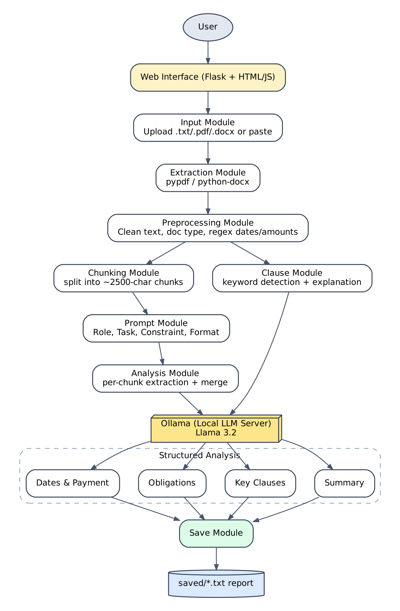

# Ex. No. 5 – LexiScan AI – Automated Legal Document Analyzer

**24CS2506 – Building Applications using GPT-4 · Monick S · URK23CS1167 · Karunya Institute of Technology and Sciences**

Runs fully **offline** with a local LLM (**Llama 3.2 via Ollama**). No cloud API needed.

## Tech stack
- **Backend:** Python + Flask (`app.py`), one file per module in `modules/`
- **LLM:** Llama 3.2 in Ollama (`llm.py` → `http://localhost:11434`)
- **Frontend:** HTML + CSS + JavaScript



## Setup (Windows, one time)
1. Install **Python 3.11+** and **Ollama** (https://ollama.com/download). Open Ollama once.
2. In PowerShell inside this folder: `.\setup.ps1`

## Run
```powershell
.\.venv\Scripts\Activate.ps1
python app.py
```
Open http://localhost:5005

## Lab record + demo video
```powershell
.\make_record.ps1
```
Saves screenshots to `screenshots/`, the demo video to `videos/`, and builds `Exp5_Record_URK23CS1167.pdf`.
